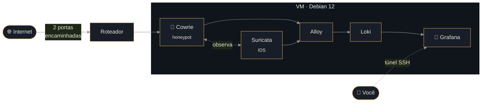

# 🔶 Posto de Observação

### Honeypot + IDS + Dashboard — laboratório de segurança defensiva

Um serviço falso que recebe ataques reais da internet, um sensor de rede que os classifica de forma independente, e um dashboard que mostra os dois lados da história ao vivo.

**[📖 Ler o guia completo →](wiki/index.html)**

 

> [!NOTE]
> Este repositório documenta uma implementação real, incluindo os erros de configuração que apareceram no meio do caminho. Eles têm capítulo próprio — são exatamente o tipo de coisa que qualquer pessoa seguindo esse caminho também vai encontrar.

## O que é isto

`Cowrie` finge ser um servidor SSH/Telnet vulnerável e registra tudo que um visitante tenta fazer dentro dele. `Suricata` não sabe nada sobre esse teatro — só observa os pacotes de rede chegando na interface e classifica padrões de forma independente. Os dois nunca dependem um do outro pra funcionar; essa separação é o que torna o sistema inteiro mais fácil de diagnosticar e mais resistente a falha silenciosa.

## Stack

| Camada | Ferramenta | Onde roda |
|---|---|---|
| Honeypot | [Cowrie](https://github.com/cowrie/cowrie) | Docker, rede isolada |
| IDS | [Suricata](https://suricata.io) | nativo (fora de container) |
| Coleta de logs | [Grafana Alloy](https://grafana.com/docs/alloy/) | nativo (fora de container) |
| Armazenamento | [Loki](https://grafana.com/oss/loki/) | Docker |
| Visualização | [Grafana](https://grafana.com/oss/grafana/) | Docker |
| Ambiente | VirtualBox + Debian 12 | — |

## Guia completo

O tutorial está em [`/wiki`](wiki/index.html), organizado em 6 capítulos navegáveis:

| # | Capítulo | Conteúdo |
|---|---|---|
| 01 | [Arquitetura & Threat Model](wiki/01-arquitetura.html) | Por que esse desenho, e o que pode dar errado no próprio laboratório |
| 02 | [Preparando o Ambiente](wiki/02-ambiente.html) | VM isolada, hardening de acesso, Docker |
| 03 | [IDS + Honeypot](wiki/03-suricata-cowrie.html) | Instalando Suricata e Cowrie, confirmando a correlação entre os dois |
| 04 | [Exposição & Dashboard](wiki/04-exposicao-dashboard.html) | Abrindo pra internet de verdade, montando o painel |
| 05 | [Troubleshooting](wiki/05-troubleshooting.html) | Todo erro real encontrado nesta implementação, e a correção de cada um |
| 06 | [Lições Aprendidas](wiki/06-licoes.html) | O que fica depois, e por onde continuar |

> [!TIP]
> Clone o repositório e abra `wiki/index.html` direto no navegador — é um site estático, não precisa de servidor nem build step. Pra publicar online, basta apontar GitHub Pages (ou qualquer hosting estático) pra pasta `wiki/`.

## Threat model (resumo)

Análise completa em STRIDE no [capítulo 1](wiki/01-arquitetura.html#threat-model-do-próprio-laboratório). Resumo das prioridades mais altas:

<strong>Ver tabela completa</strong>

 

| Ameaça | Cenário | Mitigação | Prioridade |
|---|---|---|---|
| Elevação de privilégio | Escape do sandbox do Cowrie, execução no host | Container não-privilegiado, rede Docker isolada | 🔴 Alta |
| Adulteração de evidência | Log local apagado pra cobrir rastro | Logs replicados quase em tempo real pra fora do host | 🔴 Alta |
| Exposição de informação | Dashboard acessível publicamente por engano | Bind exclusivo em `127.0.0.1`, nunca encaminhado | 🔴 Alta |
| Negação de serviço | Volume de conexões derruba o próprio IDS | Limites de recurso no container, ruleset dimensionado | 🟡 Média |
| Falsificação | Confusão entre serviço de gestão e honeypot | Gestão SSH em porta não-padrão, só na rede local | 🟡 Média |

> [!WARNING]
> Se sua rede tiver IPv6 público, regras de firewall pensadas só em IPv4 podem deixar uma porta inteira exposta sem nenhum port-forward configurado pra ela. Detalhes no [capítulo de troubleshooting](wiki/05-troubleshooting.html).

## Erros reais encontrados

Nada abaixo é hipótese — cada item apareceu de verdade numa implementação real deste guia:

- Interface de rede genérica (`eth0`) que não existe em VMs VirtualBox (o nome real costuma ser `enp0s3`)
- `docker compose up` falhando por rede externa nunca criada
- Imagem do Cowrie sem `tail`/coreutils, quebrando o fluxo comum de debug
- Firewall liberado pra "Anywhere" em vez da rede local — e o buraco correspondente em IPv6
- Grafana não enxergando o Loki por rodarem em containers Docker separados
- Permissão de diretório bloqueando o agente de coleta de logs (`/var/lib/docker` restrito a root)
- Uma ferramenta inteira (Promtail) descontinuada no meio do processo

Causa, diagnóstico e correção de cada um: [capítulo 5](wiki/05-troubleshooting.html).

## Licença

Material publicado com fins educacionais, como registro de um laboratório pessoal de segurança defensiva. Sinta-se à vontade pra adaptar, republicar com atribuição, ou usar como base pro seu próprio projeto.

Posto de Observação · honeypot + ids + dashboard

